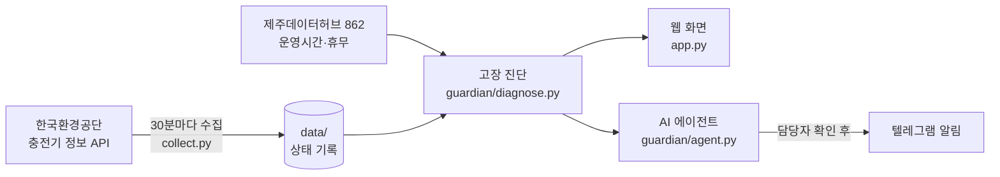

# 고장났수다 ⚡

**제주 공공 전기차 충전기의 숨은 고장과 장기 방치를 찾아내는 AI 에이전트**

> 화면에는 '사용 가능'으로 뜨는데 막상 가 보면 안 되는 충전기, 몇 달째 아무도 손보지 않은 충전기.
> 고장났수다는 30분마다 제주 충전기 상태를 모아, 이용 기록만으로 이런 충전기를 찾아내고 점검 순서를 정해 줍니다.

- **서비스 주소**: https://jeju-error.streamlit.app/
- **대회**: 제주 AI·빅데이터 활용 AI Agent 개발 챌린지 (DAKER, 2026)
- **필수 데이터**: 제주데이터허브 「[인구, 생활] 전기자동차 충전소 정보」 (862번) → [데이터 명세서](docs/데이터_명세서.md)

---

## 무엇을 해결하나요

| 문제 | 고장났수다가 하는 일 |
|---|---|
| 공식 상태는 '사용 가능'인데 실제로는 고장난 충전기 (숨은 고장) | 같은 충전소·주변 충전기는 꾸준히 쓰이는데 혼자만 이용이 끊긴 충전기를 통계로 찾아냄 |
| 통신두절·점검중으로 오래 방치된 충전기 | 상태가 바뀐 시각과 마지막 충전 시각으로 **며칠째 방치인지** 계산 |
| 어디부터 고쳐야 할지 모름 | 이용량·방치 기간·근처 대체 충전기 수로 **점검 우선순위 점수** 계산 |
| 1년 넘게 아무도 안 쓰는 '유령 충전기' | 수리 대상과 분리해 **철거·목록 정리 검토(행정 트랙)** 로 따로 표시 |

판정은 모두 **추정**이며 고장 확정이 아닙니다. 화면마다 현장 확인 결과를 기록하는 칸이 있습니다.

## 화면 구성

| 화면 | 누가 | 무엇을 |
|---|---|---|
| **홈** | 모두 | 서비스 소개, 실제 진단 사례 한 건, 사용자별 화면 안내 |
| **공공기관** | 제주도·공공기관 | 운영기관·지역(제주시/서귀포시, 읍·면)별 고장·방치 현황, 지도, 오늘 점검할 곳, 점검 지시서(여러 곳 한꺼번에, 서명란 포함) |
| **운영사** | 충전기 운영사 | 내 충전기 중 손볼 곳(점검 순서), 점검 목록 내려받기, 텔레그램 알림 |
| **도민** | 전기차 이용자 | 가기 전에 충전소의 지금 상태 확인 (사용 가능 / 충전 중 / 방문 전 확인 / 이용 불가). 이용 제한·버스 차고지·이름에 "운수사 전용"·"입주민 전용"·"직원"이 들어간 곳은 뺍니다 |
| **AI 에이전트** | 모두 | 자연어 질문에 데이터를 직접 계산해 답변, 점검 현황 보고서 작성 |

모든 화면 오른쪽 아래의 **'AI에게 묻기'** 버튼으로 지금 보는 화면에 맞춘 질문을 바로 할 수 있습니다.

## 5분 체험 시나리오 (처음 쓰는 분용)

프로그램을 켜면(배포 사이트 또는 `run.bat`) 첫 화면이 뜨기까지 20초쯤 걸립니다. 그다음 아래 순서대로 눌러 보세요. **API 키가 없어도 모두 됩니다** (B-2만 키 필요).

### A. 공공기관 담당자: "오늘 어디부터 점검하지?" (3분)

| 단계 | 누를 곳 | 확인할 것 |
|---|---|---|
| 1 | 위쪽 메뉴 **공공기관** | 맨 위 **경보 / 주의 / 관찰 / 철거·정리 검토** 대수와 지도. 빨간 점이 경보입니다 |
| 2 | 아래 **오늘 점검할 곳** 표에서 **1위 줄의 아무 칸** 한 번 클릭 | 표 아래에 **점검 지시서**가 열립니다. 판정, 방치 기간, **근거 문장**(예: "같은 충전소 다른 ○대는 평균 하루 ○번 쓰이는데, 이 기기는 열려 있던 ○일 동안 0번"), 권장 조치, 이용 그래프 |
| 3 | 지시서의 **지시서 내려받기** | 현장에 들고 갈 지시서 파일이 내려받아집니다. 점검 뒤에는 **현장 확인 결과**에 체크하고 점검자·확인 책임자가 서명합니다 |
| 3-1 | 표 아래 **오늘 점검 지시서 한꺼번에 받기** → **인쇄용 (PDF로 저장)** | 고른 충전기(처음엔 상위 10곳)의 지시서가 한 장에 한 건씩 담긴 파일. 열어서 인쇄 → PDF로 저장 |
| 4 | 오른쪽 아래 파란 **AI에게 묻기** → **운영기관별 현황** | 작은 창에 운영기관별 고장 현황이 답으로 나오고, 아래에 **"✓ 답 속 숫자를 모두 데이터 계산 결과와 대조했습니다"**가 뜹니다 |

### B. AI 에이전트: "질문하고 보고서 받기" (2분)

| 단계 | 누를 곳 | 확인할 것 |
|---|---|---|
| 1 | 위쪽 메뉴 **AI 에이전트** → **질문하기** 탭 → **오늘 경보 목록** 버튼 | 경보 충전기 표가 답으로 나옵니다. **에이전트가 한 일**을 펼치면 어떤 도구로 계산했는지 보입니다 |
| 2 | (키가 있을 때) 아래 입력칸에 `환경부 충전기 중 통신 끊긴 거 몇 대야?` | AI가 스스로 도구를 골라 계산한 숫자로 답합니다. 최신 질문이 맨 위에 옵니다. 답에 충전소가 나오면 그 이름 버튼을 눌러 도민 지도에서 위치를 봅니다 |
| 3 | **점검 보고서** 탭 → 보고서 대상 고르기 → **보고서 만들기** | 운영기관별 점검 현황 보고서가 만들어집니다 |
| 4 | **한글·워드용 (HTML, 인쇄하면 PDF)** | 한글·워드에서 열거나 인쇄해 PDF로 저장할 수 있습니다 |

### C. 운영사: "내 충전기 알림 받기" (1분)

| 단계 | 누를 곳 | 확인할 것 |
|---|---|---|
| 1 | 위쪽 메뉴 **운영사** → 맨 위 운영사 버튼 하나 (예: **제주특별자치도**) | 내 충전기 수, 오늘 경보, 주의·관찰 대수 |
| 2 | **오늘 보낼 알림** | 담당자에게 보낼 점검 요청 문구 미리보기. 텔레그램 설정 시 **확인하고 텔레그램으로 보내기**로 발송 |
| 3 | **점검 목록** → **목록 내려받기 (CSV)** | 엑셀로 열리는 점검 순서 목록 |

### D. 도민: "가기 전에 확인" (30초)

| 단계 | 누를 곳 | 확인할 것 |
|---|---|---|
| 1 | 위쪽 메뉴 **도민** → 검색칸에 `공항` | 충전소마다 **지금 사용 가능 대수**와 사용 가능 / 충전 중 / 방문 전 확인 / 이용 불가 막대 |
| 2 | 카드 오른쪽 **지도** 버튼 | 지도가 그 충전소로 이동합니다 |

## 작동 방식



1. **수집**: 오라클 클라우드 무료 서버가 30분마다 `collect.py`를 실행해 제주 충전기 상태를 저장하고 이 저장소에 올립니다.
2. **진단**: `guardian/diagnose.py`가 쌓인 상태 기록과 허브 운영시간을 함께 보고 충전기마다 판정·근거·우선순위를 계산합니다.
3. **보여주기**: `app.py`(Streamlit)가 사용자별 화면으로 보여 줍니다. 진단 결과는 30분 동안 캐시합니다.
4. **에이전트**: 질문을 받으면 LLM이 진단 데이터 조회 도구를 골라 쓰고, 답에 나온 숫자를 데이터와 대조한 뒤 보여 줍니다.

## 고장 진단 규칙 (요약)

| 코드 | 이름 | 이렇게 판단합니다 |
|---|---|---|
| A1 | 운영불가 | 공식 상태가 운영중지·점검중 |
| A2 | 통신두절 | 통신이상·상태미확인이 6시간 이상(주의), 24시간 이상(경보) 연속 |
| A3 | 간헐통신 | 최근 48시간 중 절반 이상 통신이상, 상태가 오락가락, 정상 충전 0건 |
| A4 | 충전고착 | '충전 중'이 급속 4시간·완속 24시간 넘으면 주의, 급속 48시간·완속 72시간 넘으면 경보 (주말 휴무 기관은 주말엔 주의까지만) |
| B1 | 숨은고장(형제) | 같은 충전소 같은 종류 충전기는 쓰이는데 이 충전기만 이용 0건, 우연일 확률 0.1% 미만 |
| B2 | 숨은고장(이웃) | 같은 충전소에 비교 대상이 없으면 주변 비슷한 충전기 30대(최대 10km)와 비교 |
| B3 | 실패충전 반복 | 5분 미만으로 끊긴 충전이 평소보다 비정상적으로 많음 |

- 등급은 **경보 > 주의 > 관찰** 세 단계입니다.
- 숨은 고장(B1·B2)은 충전기마다 원래 이용량이 다른 점(이질성)을 반영한 음이항 분포로 확률을 계산합니다. 여러 충전기를 한꺼번에 검사해서 생기는 우연한 경보는 BH 보정으로 줄였습니다.
- 운영시간이 짧거나 주말에 쉬는 충전소는 **실제로 열려 있던 시간만** 셉니다(허브 862 운영시간·휴무).
- 기준 숫자의 근거와 자세한 계산은 [데이터 명세서 5장](docs/데이터_명세서.md#5-진단-결과-데이터-파생)에 있습니다.

## AI 에이전트

- **모델**: OpenAI Chat Completions (기본 `gpt-4.1-mini`, 환경변수 `OPENAI_MODEL`로 변경)
- **도구 8개**: 전체 현황 / 점검 우선순위 / 충전소 검색 / 충전기 상세 / 1년 넘게 방치 / 허브 대비 변화 / 운영사 점검 요청서 초안 / 이동 시간(충전소 좌표로 직선거리를 계산한 추정치, 외부 통신 없음)
- **숫자 대조**: 답에 나온 숫자가 도구 계산 결과에 없으면 한 번 다시 답하게 하고, 그래도 다르면 화면에 경고를 띄웁니다.
- **사람 확인 후 발송**: 요청서는 초안만 만들고, 담당자가 확인 버튼을 눌러야 텔레그램으로 나갑니다.
- **API 키가 없어도** 질문 버튼(오늘 경보 목록·운영기관별 현황·1년 넘게 방치된 곳·1년 전과 비교), 충전소 검색, 점검 보고서는 코드만으로 동작합니다.

## 예측 고정과 검증

진단이 실제로 맞는지 확인하기 위해 예측을 미리 고정하고 나중에 채점합니다.

1. `python -m guardian.freeze freeze` → `predictions/<날짜_시각>/`에 숨은 고장 상위 20대, 수리 우선 20대, 비교용 정상 20대, 코드·데이터 지문(md5)을 저장
2. 7일 뒤 `python -m guardian.freeze score predictions/<폴더>` → 이후 실제 이용 기록으로 적중 여부 채점

고정에 쓴 코드는 `manifest.json`에 적힌 지문(md5)의 버전이며 깃허브 기록에 남아 있습니다. 고정 뒤 `diagnose.py`는 계산 속도만 개선했고(약 34초 → 7초), 같은 데이터로 돌려 고정 파일과 **바이트까지 같은 결과**가 나오는 것을 확인했습니다.

## 폴더 구조

```
app.py                  웹 화면 (Streamlit)
run.bat                 윈도우에서 더블클릭으로 실행
.env.example            키 설정 예시 (실제 키는 .env, 저장소에 올리지 않음)
collect.py              환경공단 API 수집기 (30분마다 실행)
hub_stations.py         제주데이터허브 862 충전소 목록 내려받기
guardian/
  diagnose.py           고장 진단 v2 (판정·근거·우선순위)
  judge.py              데이터 읽기 공통 함수, 1단계 판정
  agent.py              AI 에이전트 (도구·숫자 대조·보고서)
  freeze.py             예측 고정·채점
data/
  status/               30분마다 쌓이는 상태 기록 (하루 1파일)
  latest.csv.gz         가장 최근 상태 1회분
  master/, master_full/ 하루 1번 저장하는 충전기 기본 정보
  hub/stations.json     제주데이터허브 862 충전소 정보 (2025-09-21 기준)
  kepco_jeju_public_2023_2026.csv.gz   한전 충전 이력 (기준 검증용)
docs/데이터_명세서.md     데이터 출처·항목·진단 규칙 상세
predictions/            고정한 예측과 채점 결과 (예측 고정과 검증 참고)
.github/workflows/      GitHub Actions 수집 설정 (초기 수집용)
```

## 직접 실행하기

Python 3.11 이상이 필요합니다.

**윈도우**: `run.bat`을 더블클릭하면 필요한 프로그램을 설치하고 화면을 엽니다.

**그 밖의 환경**:

```bash
pip install -r requirements.txt
streamlit run app.py
```

브라우저에서 `http://localhost:8501`이 열립니다. 저장소에 들어 있는 `data/`로 바로 진단하며, 첫 화면은 진단 계산 때문에 20초 정도 걸립니다.

**선택 설정** (없어도 실행됩니다): `.env.example`을 복사해 `.env`로 이름을 바꾸고 값을 채웁니다. `run.bat`이 자동으로 불러옵니다. 다른 방법으로는 `.streamlit/secrets.toml`이나 환경변수에 같은 이름으로 넣어도 됩니다.

| 이름 | 용도 |
|---|---|
| `OPENAI_API_KEY` | AI 에이전트 자유 질문 (없으면 질문 버튼·검색·보고서만 동작) |
| `TELEGRAM_TOKEN`, `TELEGRAM_CHAT_ID` | 운영사 알림 발송 |
| `KECO_KEY` | 데이터 직접 수집 (`python collect.py`) |
| `HUB_KEY` | 허브 862 다시 내려받기 (`python hub_stations.py` → `data/hub/stations.json`) |

> 키와 토큰은 저장소에 올리지 않습니다. 배포 사이트는 Streamlit Cloud의 Secrets에만 저장합니다.

## 외부 통신 주소

보안 프로그램이 있는 PC에서는 아래 주소를 허용해 주세요. **처음 설치할 때 1·2번만 열려 있으면** 나머지가 막혀도 화면과 진단은 동작합니다(저장소에 넣어 둔 `data/`로 계산).

| # | 주소 | 쓰는 곳 | 막히면 |
|---|---|---|---|
| 1 | `pypi.org`, `files.pythonhosted.org` | 처음 설치할 때 프로그램 내려받기 (`run.bat`, `pip install`) | 설치 불가 → 미리 설치된 PC에서 실행 |
| 2 | `localhost:8501` | 내 PC 안에서 화면 띄우기 (밖으로 나가지 않음) | 화면이 안 열림 → 브라우저 주소창에 직접 입력 |
| 3 | `api.openai.com` | AI 에이전트 자유 질문, 보고서 요약 | 질문 버튼·검색·보고서는 그대로, 자유 질문만 안 됨 |
| 4 | `basemaps.cartocdn.com` | 지도 배경 그림 | 지도 배경만 빈 화면, 충전기 점·표는 그대로 |
| 5 | `cdn.jsdelivr.net` | 화면 글꼴 (Pretendard) | 기본 글꼴로 바뀜 |
| 6 | `api.telegram.org` | 운영사 화면의 텔레그램 알림 발송 | 알림만 안 감 |
| 7 | `apis.data.go.kr` | 데이터 직접 수집 (`collect.py`, 선택) | 저장소 데이터로만 진단 |
| 8 | `open.jejudatahub.net` | 허브 862 다시 내려받기 (`hub_stations.py`, 선택) | 저장소의 `data/hub/stations.json` 사용 |
| 9 | `github.com` | 최신 코드·데이터 받기 (선택) | 받아 둔 묶음(zip)으로 실행 |

이 밖의 주소로는 아무것도 보내지 않습니다. Streamlit 사용 통계 전송도 꺼 두었습니다(`.streamlit/config.toml`의 `gatherUsageStats = false`).

## 오류 및 제약사항

### 자주 나는 오류

| 증상 | 원인 | 해결 |
|---|---|---|
| `run.bat`이 "파이썬이 없습니다"라고 함 | Python 미설치 또는 PATH 미등록 | python.org에서 3.11 이상 설치, 설치 첫 화면의 **Add python.exe to PATH** 체크 |
| "설치에 실패했습니다" | 인터넷 또는 `pypi.org` 차단 | 위 외부 통신 주소 1번 허용 |
| 첫 화면이 20초쯤 멈춰 있음 | 정상. 충전기 4천여 대를 진단하는 중 | 기다리면 됨. 이후 30분 동안은 바로 열림 |
| 브라우저가 안 열림 | 자동 열기 실패 | 브라우저 주소창에 `http://localhost:8501` 입력 |
| 주소가 `localhost:8502`처럼 다른 번호로 열림 | 이미 한 번 실행 중이라 다음 번호를 씀 | 그대로 써도 됨. 정리하려면 열려 있는 검은 창을 모두 닫고 다시 실행 |
| AI 에이전트에 "API 키 없음" | `OPENAI_API_KEY` 미설정 | `.env`에 키 입력. 없어도 질문 버튼·검색·보고서는 동작 |
| "지금은 AI에 연결하지 못했습니다" | 키 오류, 잔액 부족, `api.openai.com` 차단 | 키·잔액 확인, 외부 통신 주소 3번 허용 |
| 지도 배경이 회색 | `basemaps.cartocdn.com` 차단 | 외부 통신 주소 4번 허용 (점과 표는 정상) |

### 제약사항

- **추정이지 확정이 아닙니다.** 숨은 고장은 이용 기록으로 계산한 확률입니다. 일반차 주차, 공사, 주변 행사로도 이용이 끊길 수 있어 화면마다 현장 확인 결과를 기록하게 했습니다.
- **30분 간격 수집**입니다. 30분보다 짧은 상태 변화는 놓칠 수 있습니다.
- **수집 공백**: 수집 초기(2026-11-04~05)에 4~8시간 공백이 4번 있었습니다. 2026-11-05 23:00 이후로는 30분마다 끊김 없이 수집했습니다.
- **저장소 데이터는 받은 시점에 멈춰 있습니다.** 실시간 상태는 배포 사이트(수집 서버와 연결)에서 볼 수 있고, 내려받아 실행하면 받은 시점까지의 데이터로 진단합니다.
- **환경공단 API 값에 의존**합니다. 운영사가 상태를 늦게 또는 한꺼번에 갱신하면 방치 일수가 실제와 다를 수 있습니다(일괄 갱신은 따로 표시).
- **대상은 공공 운영기관 5곳**(제주도·환경부·제주에너지공사·제주전기자동차서비스·제주테크노파크)입니다. 민간 완속 충전기는 진단하지 않습니다.
- **허브 862는 2025-09 기준**이라 그 뒤 생긴 충전소는 운영시간을 24시간으로 가정합니다.
- **AI 답변**은 숫자를 데이터와 대조하지만 문장 표현은 틀릴 수 있습니다. 숫자가 안 맞으면 화면에 경고가 뜹니다.
- **텔레그램은 알림 발송만** 합니다(대화형 챗봇 아님). 담당자가 확인 버튼을 눌러야 보냅니다.
- **개인정보는 없습니다.** 충전기·충전소 단위 데이터만 씁니다.

## 사용 데이터

| 데이터 | 쓰임 |
|---|---|
| 한국환경공단 전기자동차 충전소 정보 API | 30분마다 상태 수집 → 진단의 기본 재료 |
| 제주데이터허브 「[인구, 생활] 전기자동차 충전소 정보」 862 (2025-09 기준) | 열린 시간 환산, 주말 휴무 보정, 전용 충전기 제외, 1년 전 대비 충전기 수 변화 |
| 한전 공용 충전기 충전 이력 (제주, 2023-01 ~ 2026-09) | 진단 기준 숫자 검증(백테스트), 한전 충전소 월별 이용 그래프 |

자세한 항목과 건수는 [데이터 명세서](docs/데이터_명세서.md)를 보세요.

## 팀 고장났수다

| 이름 | 역할 |
|---|---|
| 이은규 | 팀장, 데이터 분석 (Leader, Data Analyst) |
| 금도윤 | 데이터 분석 (Data Analyst) |
| 김태민 | 데이터 엔지니어링 (Data Engineer) |
| 이재성 | 데이터 엔지니어링, 디자인 (Data Engineer, Designer) |
